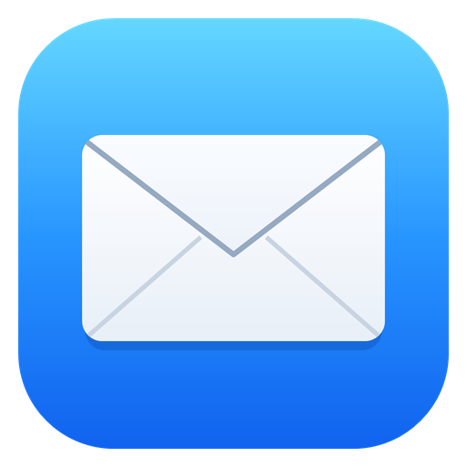

<div align="center">



# Pear Mail

**A fast, native Windows mail client for iCloud, Gmail, Outlook.com and any IMAP account.**

[](https://github.com/romanmgelman/pearmail/releases/latest)
[](#install)
[](https://www.rust-lang.org/)
[](https://tauri.app/)
[](LICENSE)

[Install](#install) · [Accounts](#accounts) · [Features](#features) · [Shortcuts](#keyboard-shortcuts) · [Build from source](#build-from-source) · [Privacy](PRIVACY.md) · [Terms](TERMS.md)

</div>

---

Pear Mail brings the clean three-pane layout of iCloud Mail to the Windows desktop: a mailbox sidebar, the message list and a reading pane, with light and dark themes, a floating compose window and full keyboard control. It is written in Rust on Tauri 2 + WebView2, so it starts instantly, uses little memory, and keeps your mail cached for offline reading.

## Highlights

- 📬 **Every account in one place.** iCloud, Gmail, Outlook.com, Yahoo, AOL, Fastmail, Zoho, GMX or any IMAP server, with unified *All Inboxes*, *VIP* and *Flagged* views.
- ⚡ **Instant and offline.** Mail is cached locally in SQLite, only new messages are downloaded, and IMAP IDLE delivers mail live.
- 🌗 **Beautiful reading.** HTML email keeps its layout, wide newsletters scale to fit, and dark mode recolors messages to match.
- 🔒 **Private by design.** Passwords and tokens live only in Windows Credential Manager, and message HTML renders in a sandboxed, script-free frame.
- ⌨️ **Keyboard first.** Shortcuts for everything, plus undo for delete, move and archive.

## Install

1. Download `pearmail.exe` from the [latest release](https://github.com/romanmgelman/pearmail/releases/latest).
2. Run it. No installer is needed. It requires the WebView2 runtime, which ships with Windows 11 and most Windows 10 PCs.
3. Add an account from the **⋯** menu at the bottom left → **Add Account…**

> [!NOTE]
> The executable isn't code-signed yet, so Windows SmartScreen may warn on first launch. Choose **More info → Run anyway**, or [build it yourself](#build-from-source).

## Accounts
Pear Mail supports several accounts at once: iCloud, Gmail, Yahoo, Outlook.com/Hotmail, AOL, Fastmail, Zoho, GMX and any other IMAP provider. Add them from the account menu (⋯ at the bottom left) → **Add Account…**, or from **Settings → Accounts**. "All Inboxes", VIP and Flagged combine every account. Each account also gets its own section in the sidebar.

Passwords and sign-in tokens are stored only in **Windows Credential Manager** (entries named "Pear Mail"). Removing an account deletes its secret and its saved mail from this computer. Nothing is deleted from the server.

| Provider | How to sign in |
|---|---|
| iCloud | Email + **app-specific password**: account.apple.com → Sign-In and Security → App-Specific Passwords. (Apple doesn't let third-party apps use Apple Account sign-in for mail.) |
| Gmail | Email + **app password** (requires 2-Step Verification): myaccount.google.com/apppasswords. Or use **Sign in with Google** after a one-time Google Cloud setup (see below). |
| Yahoo / AOL | Email + **app password** from the account's security page ("Generate app password"). |
| Outlook.com / Hotmail / Live | **Sign in with Microsoft** in your browser. Microsoft no longer accepts passwords from mail apps. Needs a one-time app registration (see below). |
| Other | Email + password. Server settings are found automatically through Mozilla's provider database; otherwise you enter them yourself. |

### One-time setup for "Sign in with Microsoft"
1. Go to portal.azure.com → **App registrations** → **New registration**. Name it "Pear Mail". Choose **Personal Microsoft accounts only** (or an option that includes personal accounts).
2. Redirect URI: **Public client/native (mobile & desktop)**, value `http://localhost`. Register.
3. Copy the **Application (client) ID** into Pear Mail. Pear Mail asks for it the first time you add an Outlook.com account; you can also change it later in Settings → Accounts.

### One-time setup for "Sign in with Google" (optional; app passwords also work)
1. console.cloud.google.com → create a project. In **Google Auth Platform**, configure the consent screen (External) and add your Gmail address as a **test user**.
2. **Clients → Create client → Desktop app**.
3. Copy the **Client ID** and **Client secret** into Pear Mail.

Your existing single iCloud account from earlier versions is moved over automatically. You don't need to sign in again.

## Build from source

You need Rust (MSVC toolchain), Visual Studio Build Tools with the C++ workload, and the WebView2 runtime (included with Windows 11).

```
cargo build --release
cargo test
```

The frontend (`ui/`) is plain HTML, CSS and ES modules embedded into the binary at compile time, so no Node build step is needed.

## Features
- **Contact photos.** Photos from your iCloud Contacts (synced over CardDAV with the same app-specific password, refreshed every 6 hours) appear as rounded squares in the message list and reading pane. Senders without a photo show their initials.
- **Saved mail.** Messages are cached on disk in `%APPDATA%\PearMail\cache-<account>.sqlite`, so the app opens instantly and works offline. Only new mail is downloaded, and the 30 newest bodies are prefetched in the background. Signing out deletes the cache.
- **Outlook-style reading.** HTML email keeps its original layout, wide newsletters scale to fit, and dark mode recolors emails to match (☀ shows the original). It also has colored sender avatars, Reply/Reply all/Forward on every message, Save all attachments, and zoom with Ctrl+= / Ctrl+- / Ctrl+wheel.
- **Pictures from the web** load automatically. You can switch to "Trusted senders only" in Settings, then use "Always Load from Sender" per sender.
- **Message list.** Messages are grouped by date (Today, Yesterday, This Week…), attachment names show in the list, and hovering a row shows read/flag/delete buttons. Sender pictures are optional.
- **Undo** for delete, move and archive (Ctrl+Z or the Undo button, for 6 seconds).
- **New-mail notifications**, unread count in the window title, and the window size and position are remembered. Only one copy of the app can run at a time.
- **Settings** (Ctrl+,) for theme, message dark mode, preview lines, text size, signature, notifications and more.
- IMAP over TLS (`imap.mail.me.com:993`) and SMTP with STARTTLS (`smtp.mail.me.com:587`)
- Mailboxes: Inbox, VIP, Flagged, Drafts, Sent, Junk, Trash and Archive, plus your own folders (create, rename, delete), with unread counts
- Message list with unread dots, flags, replied and attachment markers, 0–2 preview lines, infinite scroll, multi-select (Ctrl/Shift) and drag-and-drop onto folders
- Search (from, to, subject, body) and filters (Unread, Flagged, Addressed to Me, With Attachments)
- Reading pane with the HTML body in a sandboxed, script-free frame, inline images, attachments (open or save), all headers and message source
- Compose, Reply, Reply All and Forward with recipient tokens and autocomplete, rich text, attachments, draft autosave to Drafts, and a copy of sent mail saved to Sent
- Live updates through IMAP IDLE, plus polling every 2 minutes
- Light, dark or system theme, resizable list pane, and a collapsible sidebar

## Keyboard shortcuts
| Keys | Action |
|---|---|
| Ctrl+N | New message |
| Ctrl+R / Ctrl+Shift+R | Reply / Reply All |
| Ctrl+Shift+F | Forward |
| Ctrl+Shift+U | Mark read/unread |
| Ctrl+Shift+L | Flag/unflag |
| Ctrl+Shift+J | Move to Junk / back to Inbox |
| Ctrl+Shift+N | Refresh mail |
| Delete | Move to Trash |
| E | Archive |
| Ctrl+Z | Undo last move/delete |
| F5 | Refresh |
| Ctrl+= / Ctrl+- / Ctrl+0 | Zoom message |
| Ctrl+, | Settings |
| ↑ / ↓ (Shift to extend) | Navigate messages |
| Ctrl+F | Search |
| Ctrl+Enter (in compose) | Send |

## Project layout

| Path | Contents |
|---|---|
| `src/` | Rust backend: IMAP/SMTP, OAuth, MIME parsing, SQLite cache, CardDAV contacts, notifications |
| `ui/` | Frontend: plain HTML, CSS and ES modules (no bundler) |
| `tests/` | Frontend unit tests (`node --test tests/names.test.mjs tests/threads.test.mjs`) |
| `vendor/imap-proto/` | Patched IMAP parser that accepts the `NIL` body encodings iCloud sends |

## License

Pear Mail is released under the [MIT License](LICENSE). Bundled third-party code keeps its own license: [PDF.js](ui/vendor/pdfjs/LICENSE) (Apache-2.0) and [imap-proto](vendor/imap-proto) (MIT OR Apache-2.0).

Use of Pear Mail is subject to the [Terms of Service](TERMS.md). See the [Privacy Policy](PRIVACY.md) for how your data is handled (in short: it never leaves your computer except to reach your own mail provider).

Pear Mail is an independent project and is not affiliated with Apple, Google, Microsoft or any other mail provider.
